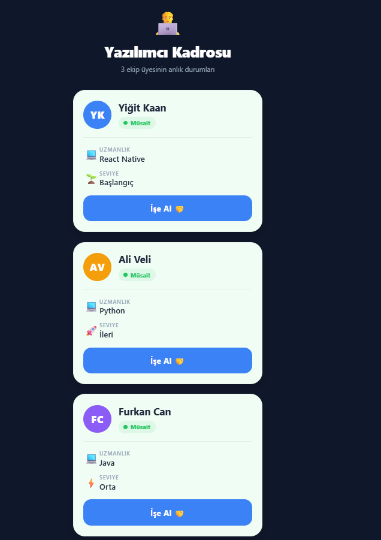

# IT Manager: Startup Tycoon

[](https://reactnative.dev/)
[](https://expo.dev/)
[](https://developer.mozilla.org/docs/Web/JavaScript)

Bir garaj girişimini "Mega Corp" seviyesine taşımaya çalıştığınız bir mobil tycoon oyunu. Yazılımcıları işe alır ve eğitir, projeleri zamanında bitirir, krizleri yönetir ve şirket bütçenizi büyütürsünüz.

<p align="center">
  
</p>

## Oyun özellikleri

- **Kadro yönetimi:** Üniversite arkadaşından Quantum Hacker'a kadar 12 geliştirici. Her biri parayla eğitilerek en fazla 5. seviyeye çıkar; bir sonrakinin kilidi, öncekinin 3. seviyeye ulaşmasıyla açılır.
- **Projeler:** Kabul ettiğiniz projeyi süre dolmadan bitirirseniz ödül alır, bitiremezseniz ceza ödersiniz. İlerleme hızını çalışan geliştiricilerin gücü belirler.
- **Rastgele olaylar:** Melek yatırımcı ve kahve molası gibi olumlu olaylar ile sunucu çökmesi ve motivasyon düşüşü gibi olumsuz olaylar.
- **Bug istilası:** Ekrandaki böcekleri temizleyene kadar geliriniz durur.
- **Yükseltmeler:** Stajyer Kampı, Çift Monitör ve Copilot gibi kalıcı gelir artışları.
- **Başarımlar ve bütçe analizi:** Başarım bildirimleri ve gelir/gider grafikleri.
- **Otomatik kayıt:** İlerleme düzenli aralıklarla ve uygulama arka plana alındığında cihaza kaydedilir.
- **Ses ve titreşim:** Ayarlardan yönetilebilen geri bildirimler.

## Teknolojiler

| Alan | Teknoloji |
| --- | --- |
| Çatı | React Native, Expo |
| Durum yönetimi | Context API, `useReducer` |
| Navigasyon | React Navigation (bottom tabs, native stack) |
| Kalıcılık | AsyncStorage |
| Animasyon ve geri bildirim | Animated API, expo-haptics, expo-av |

## Kurulum

Gereken: [Node.js](https://nodejs.org/) (LTS) ve test için [Expo Go](https://expo.dev/go) ya da bir emülatör.

```bash
git clone https://github.com/yigittozdemirr/software-card-mobile-app.git
cd software-card-mobile-app
npm install
npx expo start
```

Terminalde çıkan QR kodu Expo Go ile tarayın ya da web için <kbd>w</kbd>, Android emülatör için <kbd>a</kbd> tuşuna basın.

## Proje yapısı

```text
.
├── App.js                 # Navigasyon ve sağlayıcılar
├── src/
│   ├── components/        # Geliştirici ve proje kartları, olay pencereleri, grafikler
│   ├── context/           # GameContext: oyunun global durumu
│   ├── hooks/             # Otomatik kayıt, rastgele olaylar, ses, titreşim
│   ├── screens/           # Ana sayfa, başarımlar, bütçe, gelişim, ayarlar
│   └── constants.js       # Tema, ekonomi değerleri, geliştiriciler
└── proje_dokumantasyonu.md
```

Mimari ve oyun ekonomisinin ayrıntıları için [proje dokümantasyonuna](proje_dokumantasyonu.md) bakın.

## Geliştirici

[Yiğit Özdemir](https://github.com/yigittozdemirr)
